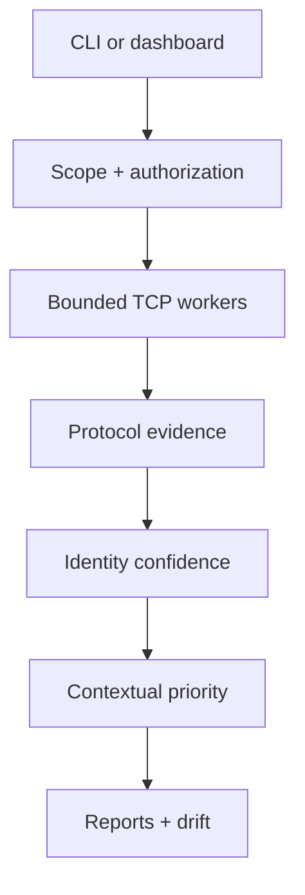

# AegisScan

**Authorized attack-surface discovery and evidence-based port intelligence.**

[](https://github.com/darshnoor30/AegisScan/actions/workflows/ci.yml)
[](https://github.com/darshnoor30/AegisScan/actions/workflows/codeql.yml)
[](pyproject.toml)
[](docs/VERIFICATION.md)
[](LICENSE)
[](SECURITY.md)

AegisScan models a real defensive workflow: define authorized scope, collect defensible evidence,
separate service hints from verified identity, prioritize exposure in context, compare drift, and
hand an owner a report they can act on. It uses standard TCP connections and runs without root.

> **Responsible use:** Scan only assets you own or have explicit permission to assess. An open port
> is an exposure signal—not proof of a vulnerability.

## Why this project stands out

| Capability | Engineering value |
| --- | --- |
| Bounded async scan engine | Queues, backpressure, concurrency, timeouts, IPv4/IPv6, CIDR, and failure handling |
| Evidence-ranked identity | Distinguishes low-confidence port hints from protocol-confirmed HTTP, HTTPS, SSH, VNC, Redis, and banner evidence |
| Contextual Exposure Model v2 | Adjusts base priority by loopback/private/public scope, confidence, environment, and asset criticality |
| False-positive resistance | Confirmed HTTP on port 27017 overrides the MongoDB port hint; non-standard SSH/HTTP can still be identified |
| Drift detection | Detects new, closed, and fingerprint-changed services between approved assessments |
| Operational reports | Emits versioned JSON, CSV, standalone HTML, and SARIF for analysts, owners, CI, and automation |
| Measured benchmark | Verifies TCP state and non-standard-port identification against deterministic loopback ground truth |
| Safe local product | Authorization, public-scope opt-in, origin checks, active-job caps, resource limits, and non-root container |
| Production scaffolding | 46 tests, 81% coverage, Ruff, mypy, CI, CodeQL, Dependabot, schema, threat model, and secure container |

## See it working

The demo starts a temporary HTTP service on **your own loopback interface**, scans it for real,
generates four reports, and shuts it down. The benchmark independently creates known HTTP, SSH, and
closed-port ground truth.

### Windows PowerShell

```powershell
py -m venv .venv
.\.venv\Scripts\Activate.ps1
python -m pip install -e ".[tls]"
aegisscan demo --output reports/demo
aegisscan benchmark --output reports/benchmark.json
aegisscan serve
```

### macOS / Linux

```bash
python3 -m venv .venv
source .venv/bin/activate
python -m pip install -e ".[tls]"
aegisscan demo --output reports/demo
aegisscan benchmark --output reports/benchmark.json
aegisscan serve
```

Open [http://127.0.0.1:8765](http://127.0.0.1:8765) after the final command.

The core scanner and dashboard have no mandatory third-party runtime dependency. The optional
`tls` extra adds X.509 subject, issuer, validity, SAN, serial-number, and expiry intelligence.

## Real scan examples

Private or loopback scope with explicit risk context:

```bash
aegisscan scan \
  --target 192.168.1.10 \
  --ports default \
  --timeout 0.8 \
  --concurrency 150 \
  --environment production \
  --asset-criticality high \
  --i-own-or-have-permission \
  --output reports/server-01
```

Multiple targets and a port expression:

```bash
aegisscan scan -t 10.10.20.0/29 -t db.internal.example \
  -p 22,80,443,3306,5432,8000-8010 \
  --environment staging --asset-criticality standard \
  --i-own-or-have-permission -o reports/approved-change-window
```

Globally routable targets are blocked unless the CLI receives both the authorization
acknowledgement and `--allow-public`. The dashboard additionally requires its server-side
`AEGISSCAN_ALLOW_PUBLIC=true` policy. See [SECURITY.md](SECURITY.md).

## Evidence and risk semantics

AegisScan deliberately keeps four concepts separate:

1. **Reachability** — a TCP connection completed from this scanner's network location.
2. **Port hint** — the port is commonly associated with a service; this is low-confidence evidence.
3. **Verified identity** — a valid protocol response or conservative signature confirmed a service,
   including selected services on non-standard ports.
4. **Contextual priority** — base severity is adjusted by network scope, confidence, environment,
   and asset criticality. Every adjustment is included in `risk_factors`.

This prevents a loopback-only port hint from receiving the same priority as a confirmed public
production service. It also prevents a process on port 27017 from being called MongoDB after HTTP
evidence proves otherwise. Read the complete [risk model](docs/RISK_MODEL.md).

The 0–100 posture index is a transparent prioritization aid. It is **not** a compliance grade,
probability of compromise, or replacement for the underlying evidence.

## Reproducible benchmark

```bash
aegisscan benchmark --output reports/benchmark.json
```

The v1.1 release benchmark passes its declared loopback matrix with:

- 100% TCP-state accuracy for two open services and one closed port;
- 100% service-identification accuracy for generated HTTP and SSH services on non-standard ports;
- zero false service claims within that matrix.

These figures apply only to the published deterministic test. They are not an Internet-wide
detection-rate claim. The [methodology and limitations](docs/BENCHMARK.md) are explicit so the
numbers cannot be presented out of context.

## Reports and drift

One scan produces:

- `report.json` — canonical, versioned evidence and contextual findings;
- `report.csv` — service inventory with identity confidence and classification method;
- `report.html` — self-contained executive and technical report;
- `report.sarif.json` — findings for SARIF-aware engineering workflows.

Compare an approved baseline with a current scan:

```bash
aegisscan diff --baseline reports/baseline.json --current reports/current.json \
  --output reports/drift.json
```

The command returns exit code `2` when a new or fingerprint-changed service is found, making it
usable as an exposure gate in controlled CI and change-management workflows.

## Architecture



The CLI and dashboard use the same scanner, policy, intelligence, storage, and reporting modules.
Read the detailed [architecture](docs/ARCHITECTURE.md) and [threat model](docs/THREAT_MODEL.md).

## Why there is no machine-learning model

TCP state and protocol identity are deterministic networking problems. Training a classifier on an
unrelated intrusion-detection dataset would add complexity without improving these decisions. A
future ML module would need task-matched historical exposure telemetry, a separately defined anomaly
objective, labelled ground truth, and independent evaluation. AegisScan v1.1 favors testable
evidence over decorative AI.

## Intentional boundaries

- no SYN/FIN/stealth scanning, packet fragmentation, IDS evasion, or raw sockets;
- no exploitation, credentials, brute force, persistence, or destructive checks;
- no unsupported vulnerability or CVE claim based only on a port number;
- no claim to replace Nmap, authenticated vulnerability scanners, or a penetration test.

AegisScan is an **asset-exposure and evidence pipeline**. Deeper validation belongs to separately
approved professional tools and asset-owner workflows.

## Development and verification

```bash
make lint
make typecheck
make test
make demo
make benchmark
make verify
docker compose up --build
```

The 46-test suite covers authorization, contextual risk, false-positive regressions, protocol
parsing, non-standard service identity, CLI, storage, reports, dashboard/API behavior, drift, and
real loopback scans. CI enforces at least 70% branch-aware coverage, Ruff, mypy, Python 3.11/3.12,
schema and JavaScript validation, demo and benchmark execution, wheel building, and the production
container. CodeQL and Dependabot add continuous security maintenance. See the
[verification record](docs/VERIFICATION.md).

## Repository map

```text
src/aegisscan/
├── scanner.py       bounded asynchronous TCP engine
├── targets.py       IP, hostname, CIDR, authorization, and scope policy
├── probes.py        port hints plus HTTP, TLS, Redis, and banner evidence
├── intelligence.py  contextual and auditable exposure priority
├── benchmark.py     deterministic loopback ground-truth measurement
├── reports.py       JSON, CSV, SARIF, and offline HTML
├── diff.py          before/after service drift
├── storage.py       atomic local scan history
├── web.py           dependency-free local API and dashboard server
└── static/          responsive analyst interface
```

## Portfolio and interview kit

Use [docs/RECRUITER_BRIEF.md](docs/RECRUITER_BRIEF.md) for honest résumé bullets, a LinkedIn
description, demo plan, and interview answers. Do not generalize the loopback benchmark into a
production detection-rate claim or say the project detects vulnerabilities.

## License

MIT © 2026 Darshnoor Kaur.
