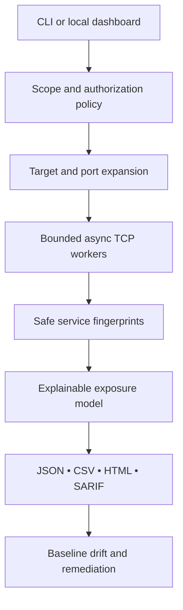

# AegisScan

**Authorized attack-surface discovery and evidence-based port intelligence.**

[](./.github/workflows/ci.yml)
[](pyproject.toml)
[](LICENSE)
[](SECURITY.md)

AegisScan is more than a “which ports are open?” script. It models a real security workflow:
define authorized scope, collect defensible evidence, prioritize exposure, compare drift, and hand
an owner a report they can act on. The scanner uses standard TCP connections and runs without root.

> **Responsible use:** Scan only assets you own or have explicit permission to assess. An open port
> is an exposure signal—not proof of a vulnerability.

## Why this project stands out

| Capability | Engineering value |
| --- | --- |
| Bounded async scan engine | Demonstrates networking, queues, concurrency, timeouts, IPv4/IPv6, and failure handling |
| Safe protocol fingerprints | Collects HTTP metadata, TLS evidence, certificate lifecycle, and server-first banners |
| Explainable exposure model | Every finding includes confidence, evidence, impact, and remediation—no fake CVE claims |
| Drift detection | Detects new, closed, and changed services between two approved assessments |
| Operational reports | Produces JSON, CSV, standalone HTML, and SARIF for people, automation, and CI |
| Local dashboard + CLI | Supports analysts and pipelines from the same tested engine, with zero mandatory dependencies |
| Product safety controls | Authorization gate, public-target opt-in, scope caps, rate controls, and non-root container |
| Production scaffolding | Tests, CI, threat model, secure container, contribution policy, versioned schema, and docs |

## See it working in 60 seconds

The demo starts a temporary HTTP service on **your own loopback interface**, scans it for real,
generates four reports, and shuts the service down.

### Windows PowerShell

```powershell
py -m venv .venv
.\.venv\Scripts\Activate.ps1
python -m pip install -e ".[tls]"
aegisscan demo --output reports/demo
aegisscan serve
```

Open [http://127.0.0.1:8765](http://127.0.0.1:8765) after the final command.

### macOS / Linux

```bash
python3 -m venv .venv
source .venv/bin/activate
python -m pip install -e ".[tls]"
aegisscan demo --output reports/demo
aegisscan serve
```

The core CLI and dashboard have no mandatory third-party runtime dependency. The optional `tls`
extra adds X.509 subject, issuer, validity, serial number, and expiry intelligence.

## Real scan examples

Private or loopback scope:

```bash
aegisscan scan \
  --target 192.168.1.10 \
  --ports default \
  --timeout 0.8 \
  --concurrency 150 \
  --i-own-or-have-permission \
  --output reports/server-01
```

Multiple targets and an explicit port expression:

```bash
aegisscan scan -t 10.10.20.0/29 -t db.internal.example \
  -p 22,80,443,3306,5432,8000-8010 \
  --i-own-or-have-permission -o reports/approved-change-window
```

Globally routable targets are deliberately blocked unless the CLI receives both the authorization
acknowledgement and `--allow-public`. The dashboard additionally requires its server-side public-scope
policy to be enabled. See [SECURITY.md](SECURITY.md).

## Port expressions and presets

Use `22,80,443`, `8000-8010`, or one of these presets:

- `default` — common infrastructure, web, remote-access, database, and management ports;
- `web` — HTTP/HTTPS and common development/application ports;
- `remote` — SSH, Telnet, RDP, VNC, and WinRM;
- `database` — relational, cache, search, and document stores;
- `mail` — SMTP, submission, POP3, and IMAP variants.

Each scan is capped at 256 resolved targets and 2,048 unique ports. Concurrency is capped at 500.

## Output that security teams can use

One scan produces:

- `report.json` — canonical, versioned result for automation and baselines;
- `report.csv` — service inventory for triage or spreadsheet analysis;
- `report.html` — self-contained executive/technical report that works offline;
- `report.sarif.json` — security findings consumable by SARIF-aware engineering workflows.

Compare an earlier approved baseline with a current scan:

```bash
aegisscan diff --baseline reports/baseline.json --current reports/current.json \
  --output reports/drift.json
```

The command returns exit code `2` when a new or fingerprint-changed service is found, making it useful
as an exposure gate in controlled CI or change-management workflows.

## Architecture



The CLI and dashboard call the same scanner, policy, intelligence, storage, and reporting modules.
That keeps security decisions consistent across human and automated use. Read the detailed
[architecture](docs/ARCHITECTURE.md) and [threat model](docs/THREAT_MODEL.md).

## What AegisScan intentionally does not do

- no SYN/FIN/stealth scanning, packet fragmentation, or IDS evasion;
- no exploitation, credentials, brute force, persistence, or destructive checks;
- no unsupported “vulnerable” label based only on a port number;
- no claim to replace Nmap, authenticated vulnerability scanners, or a formal penetration test.

AegisScan is intentionally a strong **asset exposure and evidence pipeline**. Professional tools can
validate findings more deeply after owners approve the next step.

## Development

```bash
make test
make lint
make demo
docker compose up --build
```

The test suite includes parser boundaries, authorization policy, risk calculations, HTML escaping,
drift semantics, and a real loopback integration scan. CI verifies Python 3.11/3.12, coverage,
the demo report, and the production container. See the latest local [verification record](docs/VERIFICATION.md).

## Repository map

```text
src/aegisscan/
├── scanner.py       bounded asynchronous TCP engine
├── targets.py       IP, hostname, CIDR, and scope policy
├── probes.py        safe HTTP, TLS, and banner evidence
├── intelligence.py  explainable exposure findings and score
├── reports.py       JSON, CSV, SARIF, and offline HTML
├── diff.py          before/after service drift
├── storage.py       atomic local scan history
├── web.py           dependency-free local API/dashboard server
└── static/          responsive analyst interface
```

## Portfolio and interview kit

Use [docs/RECRUITER_BRIEF.md](docs/RECRUITER_BRIEF.md) for honest résumé bullets, a LinkedIn project
description, a 90-second demo plan, and high-value interview talking points. Do not claim that the
project detects vulnerabilities; explain the evidence-to-priority distinction—that is one of its
strongest professional decisions.

## License

MIT © 2026 Darshnoor Kaur.
