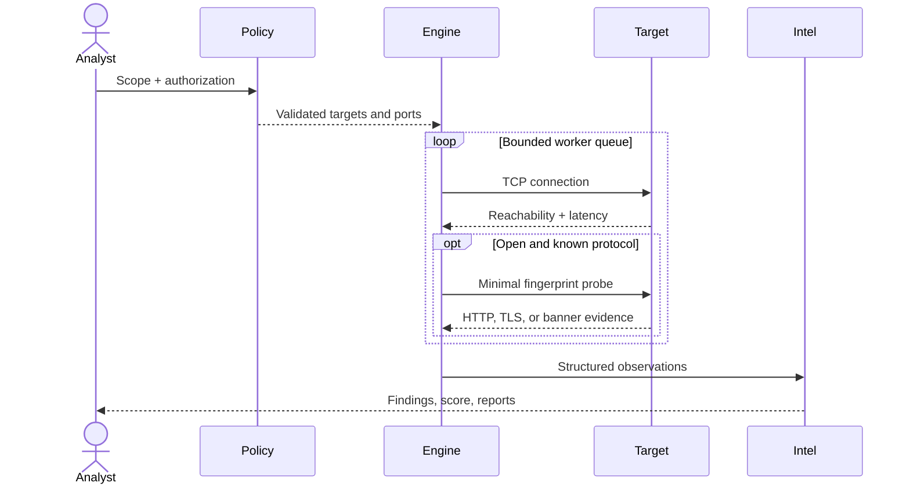

# Architecture

## Goal

AegisScan converts an authorized network scope into repeatable, machine-readable exposure evidence.
The design optimizes for bounded resource use, explainability, safe defaults, and identical behavior
between the dashboard and CLI.

## Components

| Module | Responsibility | Important decision |
| --- | --- | --- |
| `targets.py` | Resolve hosts and expand CIDRs | Deduplicate addresses; cap the resolved scope; block public targets unless explicitly enabled |
| `ports.py` | Parse presets, ports, and ranges | Reject malformed and oversized expressions before network activity |
| `scanner.py` | Coordinate probes and progress | Bounded queue prevents a full target×port task explosion |
| `probes.py` | Identify reachable services | Minimal protocol-aware requests; no authentication or exploitation |
| `intelligence.py` | Prioritize observed exposure | Evidence-based rules; public reachability promotes priority; open ≠ vulnerable |
| `reports.py` | Human and automation outputs | One canonical document powers JSON, CSV, SARIF, and escaped HTML |
| `storage.py` | Maintain local scan history | Atomic replacement avoids partial JSON files |
| `diff.py` | Compare two results | New, closed, and fingerprint-changed services are separate events |
| `web.py` | Local dashboard and JSON API | Standard library server; loopback binding and public-target denial by default |

## Scan sequence

## State semantics

- `open`: TCP connection completed within the timeout;
- `closed`: connection was actively refused;
- `filtered`: no answer arrived before the timeout;
- `error`: another operating-system/network error occurred.

Only open observations are retained individually. Aggregate counts preserve the other states without
creating unnecessarily large result files.

## Concurrency and backpressure

The producer iterates the Cartesian product of resolved targets and ports into a queue sized at twice
the worker count. Workers consume one endpoint at a time. This prevents hundreds of thousands of
coroutines from being created for a large but permitted scope. Limits are enforced before probing:

- targets: 256;
- unique ports: 2,048;
- workers: 500;
- timeout: 0.1–10 seconds.

## Evidence model

The canonical JSON result keeps three layers distinct:

1. **Observation** — address, port, state, latency, and protocol evidence.
2. **Finding** — policy interpretation with confidence, impact, and action.
3. **Summary** — score, severity counts, and scan metadata.

This separation allows rule evolution without altering historical raw evidence.

## Exposure score

The score starts at 100 and applies transparent weights: critical 25, high 14, medium 7, low 3,
informational 0, capped at a total deduction of 100. It is a prioritization aid, not a compliance
result or probability of compromise. The raw findings remain the source of truth.

