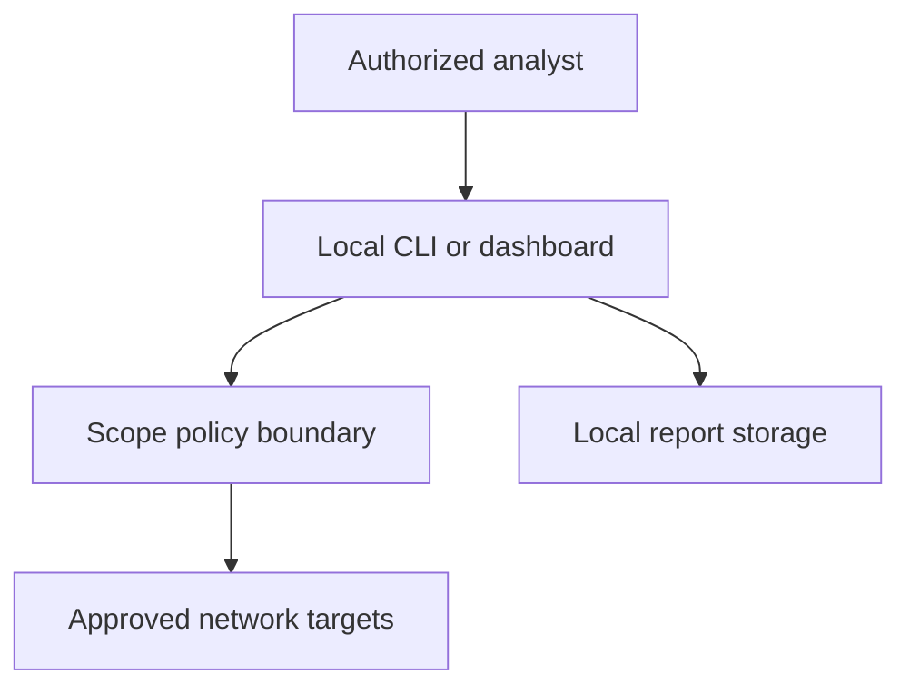

# Threat model

## Assets to protect

- systems inside the approved scan scope;
- target names and discovered network metadata;
- integrity of generated reports and scan history;
- workstation resources and local dashboard access.

## Trust boundaries

## Primary abuse cases and controls

| Risk | Control | Residual risk |
| --- | --- | --- |
| Unapproved scanning | Explicit acknowledgement; public targets blocked by default; web policy set server-side | A user with machine access can still opt in through the CLI |
| Excessive traffic | Target, port, worker, timeout, request-size caps; optional delay | A permitted maximum scan can still be noisy |
| Scanner compromise by hostile banner | Byte/read limits, decoding with replacement, HTML escaping, no shell execution | Parser bugs remain possible and require tests/review |
| Browser-triggered internal scanning | Origin/Sec-Fetch-Site validation, loopback bind, no CORS, CSP, authorization checkbox | Another local process without browser-origin headers may reach the loopback service |
| Local resource exhaustion | Two-active-job limit, 100 retained jobs, request and scan caps | Authorized maximum scans can still consume network and CPU resources |
| Dashboard exposure | Loopback default; security headers; no secrets or privileged functions | Binding to a LAN address expands access and must be protected externally |
| Partial/corrupt history | Temporary file plus atomic replace | Disk failure may still lose the latest result |
| False service/vulnerability claim | Port hints separated from confirmed identity; context risk factors; no port-to-CVE mapping | Banners may be deceptive and operators can still over-interpret evidence |
| Container breakout impact | Non-root user, no capabilities, read-only filesystem, no-new-privileges | Container network access is inherently required to scan |

## Out of scope

AegisScan does not protect against a malicious operating system, a user with full filesystem access,
or arbitrary modification of project source. Authentication is not built into the dashboard because
its supported default deployment is single-user loopback access. If deployed beyond loopback, place it
behind authenticated infrastructure and perform a fresh risk assessment.
